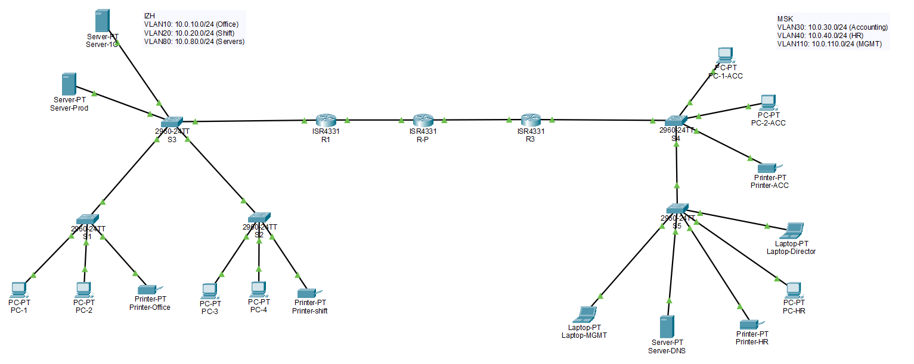

<h1>🌐 Network Labs</h1>

<strong>Практика сетевого администрирования: от базовой настройки Cisco до защищённой сети нескольких офисов.</strong>

---

## 📌 О репозитории

Здесь собраны лабораторные и итоговая работа по курсу **«Сетевой инженер»**. Внутри — описания задач, таблицы адресации, команды настройки, скриншоты проверок и файлы **Cisco Packet Tracer** (`.pkt`), где они были сохранены.

Основные темы: **Ethernet, VLAN, IPv4/IPv6, маршрутизация, OSPF, DHCP, NAT, ACL, SSH, STP, IPsec VPN и сетевые службы**.

## 🗺️ Итоговый проект: сеть двух офисов

В финальной работе спроектирована учебная сеть с площадками в **Ижевске и Москве**. В отчёте представлены:

- сегментация отделов и серверов с помощью **VLAN**;
- **PVST** и резервирование L2;
- адресация и автоматическая выдача настроек через **DHCP**;
- связь между площадками по **Site-to-Site IPsec VPN**;
- **NAT**, **ACL** и доступ к управлению по **SSH**.

**Материалы:** [подробный отчёт](final/Final%20round.md) · [проект Cisco Packet Tracer](final/final.pkt)

## 📚 Лабораторные работы

| Папка | Тема | Открыть |
|:--:|---|---|
| 00 | Первичная настройка коммутатора Cisco | [Отчёт](lab%2000/homewor%20new.md) |
| 01 | Таблица MAC-адресов коммутатора | [Отчёт](lab%2001/lab%202.md) |
| 02 | Расчёт подсетей IPv4 | [Отчёт](lab%2002/lab%2003.md) |
| 03 | IPv6-адресация и проверка связности | [Отчёт](lab%2003/lab%2003.md) · [Packet Tracer](lab%2003/lab%2003.pkt) |
| 04 | Доступ к сетевым устройствам по SSH | [Отчёт](lab%2004/lab%2004.md) · [Packet Tracer](lab%2004/lab%2004.pkt) |
| 05 | Маршрутизация между VLAN | [Отчёт](lab%2005/lab%2006.md) · [Packet Tracer](lab%2005/lab%206.pkt) |
| 06 | Резервные каналы в коммутируемой сети | [Отчёт](lab%2006/lab%2007.md) · [Packet Tracer](lab%2006/lab%2007.pkt) |
| 07a | DHCPv4 | [Отчёт](lab%2007%20dhcp%20v4/lab%2007%20dhcp%20v4.md) · [Packet Tracer](lab%2007%20dhcp%20v4/v4.pkt) |
| 07 | DHCPv6 | [Отчёт](lab%2007/lab%2008.md) |
| 08 | Безопасность коммутатора | [Отчёт](lab%2008/lab%2009.md) · [Packet Tracer](lab%2008/lab%2008.pkt) |
| 09 | OSPFv2 в одной области | [Отчёт](lab%2009/lab%2010.md) · [Packet Tracer](lab%2009/lab%2010.pkt) |
| 10 | Расширенные ACL | [Отчёт](lab%2010/lab%2011.md) · [Packet Tracer](lab%2010/lab%2011.pkt) |
| 11 | NAT для IPv4 | [Отчёт](lab%2011/lab%2012.md) · [Packet Tracer](lab%2011/lab%2012.pkt) |
| 12 | CDP, LLDP и NTP | [Отчёт](lab%2012/lab%2013.md) · [Packet Tracer](lab%2012/lab%2013.pkt) |

> **Как пользоваться:** откройте отчёт нужной лабораторной, изучите топологию и шаги настройки. Если рядом есть `.pkt`, файл можно открыть в Cisco Packet Tracer и самостоятельно воспроизвести конфигурацию.

## 🧠 Что демонстрирует этот проект

- Настройку коммутаторов и маршрутизаторов Cisco через CLI.
- Планирование IPv4/IPv6-адресации и разделение сети на VLAN.
- Диагностику связности и проверку конфигураций.
- Понимание маршрутизации, сетевой безопасности и межофисных соединений.
- Умение документировать лабораторную работу: топологии, конфигурации и результаты проверок.

## 🔗 Другие проекты

- [devops-lab](https://github.com/Andrew-Kotlov/devops-lab) — отдельная учебная DevOps-лаборатория (приватный репозиторий).
- [Pet-Travel](https://github.com/Andrew-Kotlov/Pet-Travel) — приложение для дальнейшей DevOps-практики.

---

Учебный репозиторий · Cisco / Networking / Infrastructure

