# Лабораторная работа - Реализация DHCPv4


### 	Топология


---
1.	### Таблица адресации
| Устройство | Интерфейс   | IP-адрес   | Маска подсети     | Шлюз по умолчанию |
|-------------|-------------|-------------|--------------------|--------------------|
| R1          | G0/0/0      | 10.0.0.1    | 255.255.255.252   | —                  |
| R1          | G0/0/1      | —           | —                  | —                  |
| R1          | G0/0/1.100  |             |                    | —                  |
| R1          | G0/0/1.200  |             |                    | —                  |
| R1          | G0/0/1.1000 | —           | —                  | —                  |
| R2          | G0/0        | 10.0.0.2    | 255.255.255.252   | —                  |
| R2          | G0/0/1      |             |                    | —                  |
| S1          | VLAN 200    |             |                    |                    |
| S2          | VLAN 1      |             |                    |                    |
| PC-A        | NIC         | DHCP        | DHCP               | DHCP               |
| PC-B        | NIC         | DHCP        | DHCP               | DHCP               |


2.	### Таблица VLAN

| VLAN ID | Имя VLAN | Назначенные устройства / интерфейсы |
|----------|-----------|------------------------------------|
| 100      | VLAN 100  | R1 G0/0/1.100                     |
| 200      | VLAN 200  | R1 G0/0/1.200, S1 VLAN 200        |
| 1000     | VLAN 1000 | R1 G0/0/1.1000                    |
| 1        | VLAN 1    | S2 VLAN 1                         |


---


### Задачи
Часть 1. Создание сети и настройка основных параметров устройства
Часть 2. Настройка и проверка двух серверов DHCPv4 на R1
Часть 3. Настройка и проверка DHCP-ретрансляции на R2

---
Общие сведения/сценарий:

Протокол динамической конфигурации сетевого узла (DHCP) — сетевой протокол, позволяющий сетевым администраторам управлять и автоматизировать назначение IP-адресов. Без использования DHCP  для IPv4 администратору необходимо вручную назначать и настраивать IP-адреса, предпочтительные DNS-серверы и шлюзы по умолчанию. По мере увеличения сети и перемещении устройств из одной внутренней сети в другую это становится административной проблемой.

В предложенном сценарии размеры компании увеличились, и сетевые администраторы больше не имеют возможности назначать IP-адреса для устройств вручную. Ваша задача заключается в настройке маршрутизатора R1 для назначения IPv4-адресов в двух разных подсетях. 

Примечание: Маршрутизаторы, используемые в практических лабораторных работах CCNA, - это Cisco 4221 с Cisco IOS XE Release 16.9.4 (образ universalk9). В лабораторных работах используются коммутаторы Cisco Catalyst 2960 с Cisco IOS версии 15.2(2) (образ lanbasek9). Можно использовать другие маршрутизаторы, коммутаторы и версии Cisco IOS. В зависимости от модели устройства и версии Cisco IOS доступные команды и результаты их выполнения могут отличаться от тех, которые показаны в лабораторных работах. Правильные идентификаторы интерфейса см. в сводной таблице по интерфейсам маршрутизаторов в конце лабораторной работы.

Примечание. Убедитесь, что у всех маршрутизаторов и коммутаторов была удалена начальная конфигурация. Если вы не уверены в этом, обратитесь к инструктору.

---
### Необходимые ресурсы
●	2 маршрутизатора (Cisco 4221 с универсальным образом Cisco IOS XE версии 16.9.4 или аналогичным)
●	2 коммутатора (Cisco 2960 с операционной системой Cisco IOS 15.2(2) (образ lanbasek9) или аналогичная модель)
●	2 ПК (ОС Windows с программой эмуляции терминалов, такой как Tera Term)
●	Консольные кабели для настройки устройств Cisco IOS через консольные порты.
●	Кабели Ethernet, расположенные в соответствии с топологией

---


### Часть 1. Создание сети и настройка основных параметров устройства
В первой части лабораторной работы вам предстоит создать топологию сети и настроить базовые параметры для узлов ПК и коммутаторов.
#### Шаг 1.	Создание схемы адресации
Подсеть сети 192.168.1.0/24 в соответствии со следующими требованиями:
a.	Одна подсеть «Подсеть A», поддерживающая 58 хостов (клиентская VLAN на R1).
Подсеть A
```
Расчёт: нужно минимум 58 адресов хостов.
Ближайшая подходящая сеть: 
2^6−2=62 хоста ⇒ /26 (маска 255.255.255.192)
Выделяем: 192.168.1.0/26
Диапазон хостов: 192.168.1.1 – 192.168.1.62
Broadcast: 192.168.1.63
Запись в таблицу адресации:
R1 G0/0/1.100 = 192.168.1.1 /26
```

b.	Одна подсеть «Подсеть B», поддерживающая 28 хостов (управляющая VLAN на R1). 
Подсеть B:
```
Расчёт: нужно минимум 28 хостов.
2^5−2=30 хостов ⇒ /27 (маска 255.255.255.224)
Следующая доступная сеть после подсети A: 192.168.1.64/27
Выделяем: 192.168.1.64/27
Диапазон хостов: 192.168.1.65 – 192.168.1.94
Broadcast: 192.168.1.95
Запись в таблицу адресации:
R1 G0/0/1.200 = 192.168.1.65 /27 (первый usable)
S1 VLAN 200 = 192.168.1.66 /27 (второй usable)
Шлюз по умолчанию для S1 = 192.168.1.65
```

c.	Одна подсеть «Подсеть C», поддерживающая 12 узлов (клиентская сеть на R2).
Подсеть C:
```
Расчёт: нужно минимум 12 хостов.
2^4−2=14 хостов ⇒ /28 (маска 255.255.255.240)
Следующая доступная сеть после подсети B: 192.168.1.96/28
Выделяем: 192.168.1.96/28
Диапазон хостов: 192.168.1.97 – 192.168.1.110
Broadcast: 192.168.1.111
Запись в таблицу адресации:
R2 G0/0/1 = 192.168.1.97 /28 (первый usable)
```
#### Шаг 2.	Создайте сеть согласно топологии.

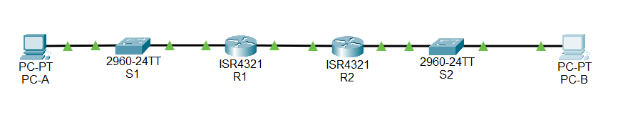

#### Шаг 3.	Произведите базовую настройку маршрутизаторов.
a.	Назначьте маршрутизатору имя устройства.
Откройте окно конфигурации
b.	Отключите поиск DNS, чтобы предотвратить попытки маршрутизатора неверно преобразовывать введенные команды таким образом, как будто они являются именами узлов.
c.	Назначьте class в качестве зашифрованного пароля привилегированного режима EXEC.
d.	Назначьте cisco в качестве пароля консоли и включите вход в систему по паролю.
e.	Назначьте cisco в качестве пароля VTY и включите вход в систему по паролю.
f.	Зашифруйте открытые пароли.
g.	Создайте баннер с предупреждением о запрете несанкционированного доступа к устройству.
h.	Сохраните текущую конфигурацию в файл загрузочной конфигурации.
i.	Установите часы на маршрутизаторе на сегодняшнее время и дату.
Примечание. Вопросительный знак (?) позволяет открыть справку с правильной последовательностью параметров, необходимых для выполнения этой команды.

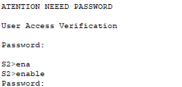  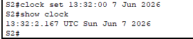

#### Шаг 4.	Настройка маршрутизации между сетями VLAN на маршрутизаторе R1
a.	Активируйте интерфейс G0/0/1 на маршрутизаторе.
```
enable
conf t
interface g0/0/1
 no shutdown
 no ip address
exit
```
b.	Настройте подинтерфейсы для каждой VLAN в соответствии с требованиями таблицы IP-адресации. Все субинтерфейсы используют инкапсуляцию 802.1Q и назначаются первый полезный адрес из вычисленного пула IP-адресов. Убедитесь, что подинтерфейсу для native VLAN не назначен IP-адрес. Включите описание для каждого подинтерфейса.
```
interface g0/0/1.100
 description VLAN100_Clients
 encapsulation dot1Q 100
 ip address 192.168.1.1 255.255.255.192
exit

interface g0/0/1.200
 description VLAN200_Management
 encapsulation dot1Q 200
 ip address 192.168.1.65 255.255.255.224
exit

interface g0/0/1.1000
 description Native_VLAN1000
 encapsulation dot1Q 1000 native
 ! IP address не задаём
exit

```
c.	Убедитесь, что вспомогательные интерфейсы работают.

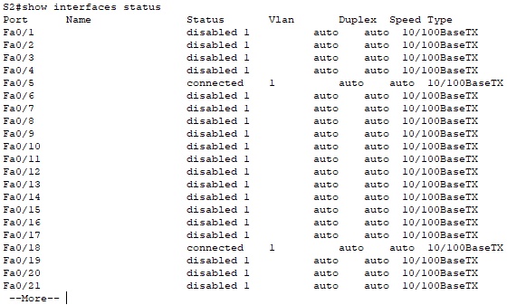

#### Шаг 5.	Настройте G0/1 на R2, затем G0/0/0 и статическую маршрутизацию для обоих маршрутизаторов
a.	Настройте G0/0/1 на R2 с первым IP-адресом подсети C, рассчитанным ранее.
```
enable
conf t
interface g0/0/1
 description R2_Client_LAN_SubnetC
 ip address 192.168.1.97 255.255.255.240
 no shutdown
end
wr
```

b.	Настройте интерфейс G0/0/0 для каждого маршрутизатора на основе приведенной выше таблицы IP-адресации.
```
enable
conf t
interface g0/0/0
 description Link_to_R2
 ip address 10.0.0.1 255.255.255.252
 no shutdown
end
wr
```

c.	Настройте маршрут по умолчанию на каждом маршрутизаторе, указываемом на IP-адрес G0/0/0 на другом маршрутизаторе.

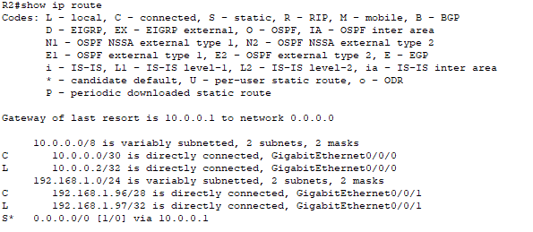

d.	Убедитесь, что статическая маршрутизация работает с помощью пинга до адреса G0/0/1 R2 от R1.

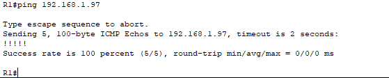

e.	Сохраните текущую конфигурацию в файл загрузочной конфигурации.

#### Шаг 6.	Настройте базовые параметры каждого коммутатора.
a.	Присвойте коммутатору имя устройства.
Откройте окно конфигурации
b.	Отключите поиск DNS, чтобы предотвратить попытки маршрутизатора неверно преобразовывать введенные команды таким образом, как будто они являются именами узлов.
c.	Назначьте class в качестве зашифрованного пароля привилегированного режима EXEC.
d.	Назначьте cisco в качестве пароля консоли и включите вход в систему по паролю.
e.	Назначьте cisco в качестве пароля VTY и включите вход в систему по паролю.
f.	Зашифруйте открытые пароли.
g.	Создайте баннер с предупреждением о запрете несанкционированного доступа к устройству.
h.	Сохраните текущую конфигурацию в файл загрузочной конфигурации.
i.	Установите часы на маршрутизаторе на сегодняшнее время и дату.
Примечание. Вопросительный знак (?) позволяет открыть справку с правильной последовательностью параметров, необходимых для выполнения этой команды.
j.	Скопируйте текущую конфигурацию в файл загрузочной конфигурации.

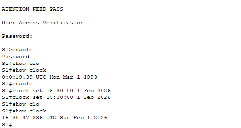


#### Шаг 7.	Создайте сети VLAN на коммутаторе S1.
Примечание. S2 настроен только с базовыми настройками. 
a.	Создайте необходимые VLAN на коммутаторе 1 и присвойте им имена из приведенной выше таблицы.

```
enable
conf t
vlan 100
 name Clients
vlan 200
 name Management
vlan 999
 name Parking_Lot
vlan 1000
 name Native
end
wr
```
b.	Настройте и активируйте интерфейс управления на S1 (VLAN 200), используя второй IP-адрес из подсети, рассчитанный ранее. Кроме того установите шлюз по умолчанию на S1.

```
conf t
interface vlan 200
 ip address 192.168.1.66 255.255.255.224
 no shutdown
exit

ip default-gateway 192.168.1.65
end
wr

```
c.	Настройте и активируйте интерфейс управления на S2 (VLAN 1), используя второй IP-адрес из подсети, рассчитанный ранее. Кроме того, установите шлюз по умолчанию на S2
```
enable
conf t

interface vlan 1
 ip address 192.168.1.98 255.255.255.240
 no shutdown
exit
ip default-gateway 192.168.1.97
end
wr
```

d.	Назначьте все неиспользуемые порты S1 VLAN Parking_Lot, настройте их для статического режима доступа и административно деактивируйте их. На S2 административно деактивируйте все неиспользуемые порты.
Примечание. Команда interface range полезна для выполнения этой задачи с минимальным количеством команд.
Закройте окно настройки.

### На S1
```
conf t
interface range f0/1-4, f0/7-24, g0/1-2
 switchport mode access
 switchport access vlan 999
 shutdown
end
wr
```

### На S2

```
conf t
interface range f0/1-4, f0/6-17, f0/19-24, g0/1-2
 shutdown
end
wr
```


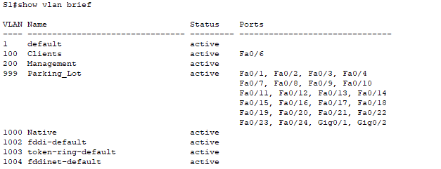


#### Шаг 8.	Назначьте сети VLAN соответствующим интерфейсам коммутатора.
a.	Назначьте используемые порты соответствующей VLAN (указанной в таблице VLAN выше) и настройте их для режима статического доступа.
Откройте окно конфигурации

##### Команды на S1 для порта PC-A (F0/6):

```
enable
conf t
interface f0/6
 switchport mode access
 switchport access vlan 100
 spanning-tree portfast
 no shutdown
end
wr
```

##### S2 F0/18 → VLAN 1 (PC-B)

```
enable
conf t
interface f0/18
 switchport mode access
 switchport access vlan 1
 spanning-tree portfast
 no shutdown
end
wr
```
b.	Убедитесь, что VLAN назначены на правильные интерфейсы.

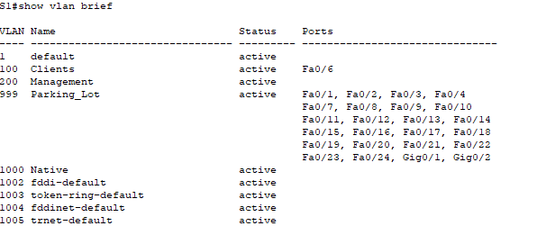

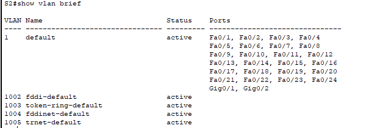

    Вопрос:Почему интерфейс F0/5 указан в VLAN 1?

    Ответ: Интерфейс F0/5 указан в VLAN 1, потому что на коммутаторе Cisco все порты по умолчанию являются access‑портами VLAN 1 (VLAN по умолчанию).

#### Шаг 9.	Вручную настройте интерфейс S1 F0/5 в качестве транка 802.1Q.

a.	Измените режим порта коммутатора, чтобы принудительно создать магистральный канал.
```
enable
conf t
interface f0/5
 switchport mode trunk

```
b.	В рамках конфигурации транка  установите для native  VLAN значение 1000.
```
 switchport trunk native vlan 1000
```
c.	В качестве другой части конфигурации магистрали укажите, что VLAN 100, 200 и 1000 могут проходить по транку.
```
 switchport trunk allowed vlan 100,200,1000
 no shutdown
exit
end
```
d.	Сохраните текущую конфигурацию в файл загрузочной конфигурации.
e.	Проверьте состояние транка.

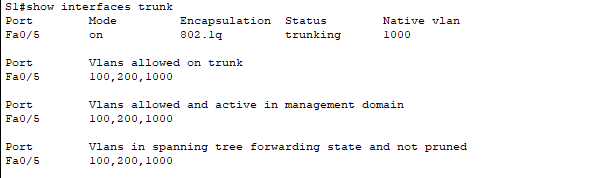

    Вопрос: Какой IP-адрес был бы у ПК, если бы он был подключен к сети с помощью DHCP?

    Ответ: Было пусто
Закройте окно настройки.


---

### Часть 2.	Настройка и проверка двух серверов DHCPv4 на R1
В части 2 необходимо настроить и проверить сервер DHCPv4 на R1. Сервер DHCPv4 будет обслуживать две подсети, подсеть A и подсеть C.
#### Шаг 1.	Настройте R1 с пулами DHCPv4 для двух поддерживаемых подсетей. Ниже приведен только пул DHCP для подсети A
a.	Исключите первые пять используемых адресов из каждого пула адресов.
Откройте окно конфигурации
```
enable
conf t
ip dhcp excluded-address 192.168.1.1 192.168.1.5
ip dhcp excluded-address 192.168.1.97 192.168.1.101
```
b.	Создайте пул DHCP (используйте уникальное имя для каждого пула).
c.	Укажите сеть, поддерживающую этот DHCP-сервер.
d.	В качестве имени домена укажите CCNA-lab.com.
e.	Настройте соответствующий шлюз по умолчанию для каждого пула DHCP.
f.	Настройте время аренды на 2 дня 12 часов и 30 минут.
```
ip dhcp pool R1_Client_LAN
 network 192.168.1.0 255.255.255.192
 default-router 192.168.1.1
 domain-name CCNA-lab.com
 lease 2 12 30
exit
```
g.	Затем настройте второй пул DHCPv4, используя имя пула R2_Client_LAN и вычислите сеть, маршрутизатор по умолчанию, и используйте то же имя домена и время аренды, что и предыдущий пул DHCP.
```
ip dhcp pool R2_Client_LAN
 network 192.168.1.96 255.255.255.240
 default-router 192.168.1.97
 domain-name CCNA-lab.com
 lease 2 12 30
exit
```
#### Шаг 2.	Сохраните конфигурацию.
Сохраните текущую конфигурацию в файл загрузочной конфигурации.
Закройте окно настройки.
#### Шаг 3.	Проверка конфигурации сервера DHCPv4
a.	Чтобы просмотреть сведения о пуле, выполните команду show ip dhcp pool .
b.	Выполните команду show ip dhcp bindings для проверки установленных назначений адресов DHCP.

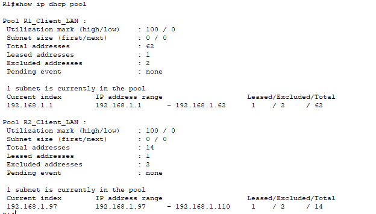


c.	Выполните команду show ip dhcp server statistics для проверки сообщений DHCP.

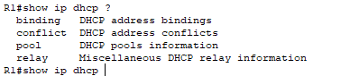

#### Шаг 4.	Попытка получить IP-адрес от DHCP на PC-A
a.	Из командной строки компьютера PC-A выполните команду ipconfig /all.
b.	После завершения процесса обновления выполните команду ipconfig для просмотра новой информации об IP-адресе.

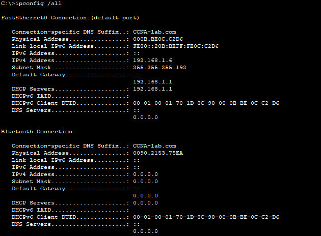


c.	Проверьте подключение с помощью пинга IP-адреса интерфейса R0 G0/0/1.

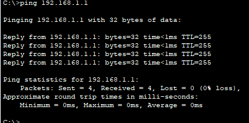


---

### Часть 3.	Настройка и проверка DHCP-ретрансляции на R2
В части 3 настраивается R2 для ретрансляции DHCP-запросов из локальной сети на интерфейсе G0/0/1 на DHCP-сервер (R1). 
#### Шаг 1.	Настройка R2 в качестве агента DHCP-ретрансляции для локальной сети на G0/0/1
a.	Настройте команду ip helper-address на G0/0/1, указав IP-адрес G0/0/0 R1.
Откройте окно конфигурации
b.	Сохраните конфигурацию.
#### Шаг 2.	Попытка получить IP-адрес от DHCP на PC-B
a.	Из командной строки компьютера PC-B выполните команду ipconfig /all.

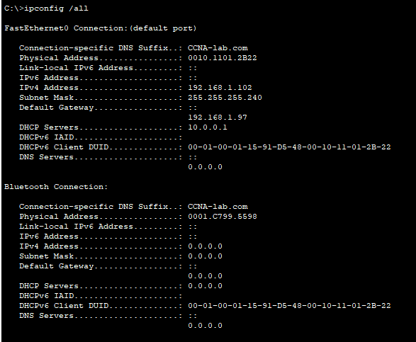

b.	После завершения процесса обновления выполните команду ipconfig для просмотра новой информации об IP-адресе.
c.	Проверьте подключение с помощью пинга IP-адреса интерфейса R1 G0/0/1.
d.	Выполните show ip dhcp binding для R1 для проверки назначений адресов в DHCP.

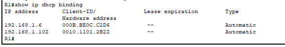

e.	Выполните команду show ip dhcp server statistics для проверки сообщений DHCP.

